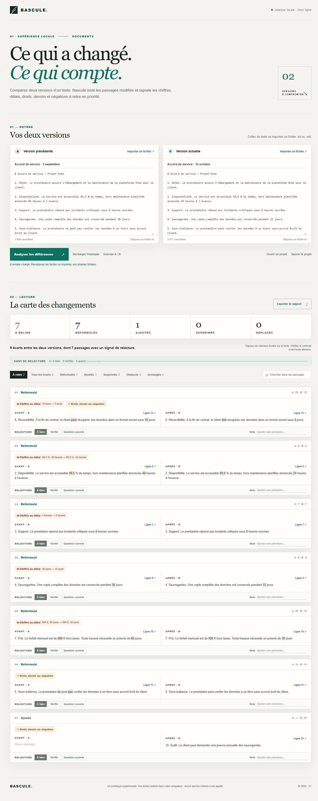

# Bascule

**Bascule** compare deux versions d'un texte et fait remonter les changements qui méritent une relecture : chiffres, délais, droits, devoirs et négations. Le moteur associe les paragraphes identiques ou proches, reconnaît les déplacements et met en évidence les mots modifiés. Tout fonctionne localement, sans compte, API, dépendance ni connexion Internet.



## Test immédiat (2 minutes)

1. Sous Windows, double-cliquez sur **[Lancer-Bascule.cmd](Lancer-Bascule.cmd)**. Une fenêtre de terminal et le navigateur s'ouvrent. Sur les autres systèmes, lancez `npm start` depuis le dossier du projet, puis ouvrez l'adresse affichée.
2. L'exemple « Accord de service » est déjà chargé et analysé. Dans **À relire**, observez notamment la suppression de « ne … pas », les délais raccourcis et le prix changé.
3. Cliquez **Tous les écarts** : une reformulation sans signal apparaît en plus. Cliquez ensuite **Ajoutés** pour retrouver la clause d'audit.
4. Modifiez `99,9 %` dans la version B et cliquez **Analyser les différences**. Marquez ensuite un passage **Vérifié** ou **Question ouverte** et ajoutez une note. Cliquez **Exporter le rapport** : le fichier Markdown téléchargé contient vos décisions de relecture et vos notes.
5. Fermez la fenêtre de terminal pour arrêter le serveur.

Adresse manuelle si le navigateur ne s'ouvre pas : **http://127.0.0.1:4318**. Node.js 20+ est requis.

## Vos propres documents

Collez les deux versions ou importez des fichiers `.txt` / `.md` par le bouton ou par glisser-déposer. Les textes doivent contenir au plus 200 000 caractères et 350 paragraphes par version. Les lignes vides séparent les paragraphes ; les titres et les puces Markdown forment également des blocs. Chaque écart peut être marqué **À faire**, **Vérifié** ou **Question ouverte**, avec une note. **Sauver le projet** exporte les deux textes et ce suivi en JSON pour une reprise ultérieure. Aucun contenu n'est conservé automatiquement ni transmis sur le réseau. Le rapport est un fichier `.md` lisible dans tout éditeur de texte.

## Fonctionnement et limites

Le moteur commence par aligner la plus longue séquence de paragraphes identiques, repère ensuite les paragraphes déplacés, puis apparie les formulations proches avec une similarité de mots et de caractères. Les autres passages sont classés ajoutés ou supprimés. Les signaux « chiffre ou délai » et « droit, devoir ou négation » reposent sur des motifs explicites en français et en anglais. Ils indiquent **où relire**, sans conclure sur le sens ou la portée juridique. Une reformulation très profonde peut apparaître comme une suppression et un ajout ; deux clauses très similaires peuvent être appariées imparfaitement. Vérifiez toujours le contexte.

Cette V1 vise les documents en texte brut ou Markdown. Les PDF et fichiers Word doivent d'abord être exportés en texte. Aucun modèle d'IA ni service distant n'est utilisé.

## Vérification technique

```powershell
npm test
```

Exécutez cette commande depuis le dossier du projet. Le test navigateur facultatif sous Windows se lance avec `node tests/browser-smoke.mjs` (Chrome requis). Pour démarrer le serveur : `npm start`. Il ne répond que sur `127.0.0.1` et ne sert que les fichiers de l'application.
